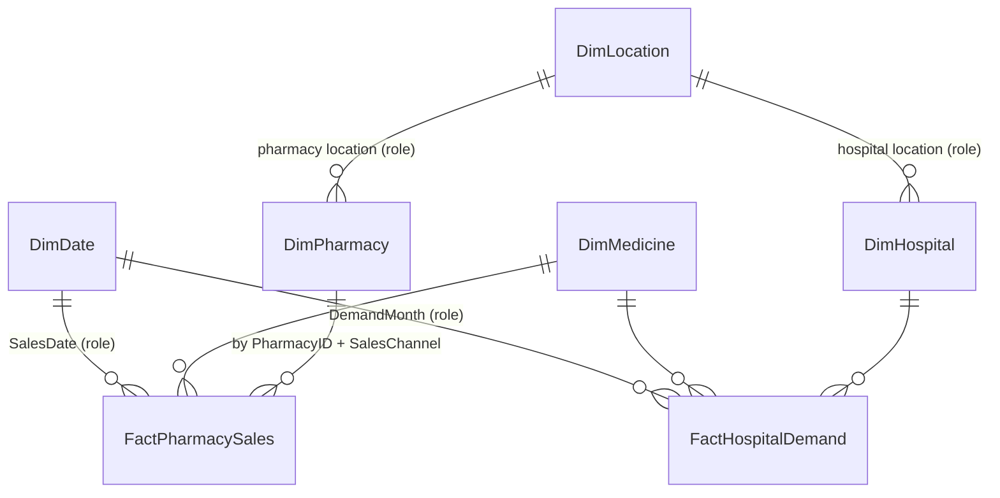

# Phase 1 — Sales & Demand Intelligence (SDI) mart: design

WBS 3.1 (dimensional model) / 3.2.2 (validation) / 3.3 (serving) / 3.4 (query layer).

This document describes the **Excel-aligned** SDI star schema exactly as built.
The **single source of truth** for the design is the hand-edited workbook
[`Milestone-1-Deliverables/Milestone.1.SDI.DWH.Excel.xlsx`](../Milestone-1-Deliverables/Milestone.1.SDI.DWH.Excel.xlsx)
(never modified or regenerated); this `.md` is its text companion. The older
`docs/archive/phase1_sdi_design_OLD.xlsx` is retired. Sources: `01_master_data.csv`,
`05_pharmacy_sales_data.csv`,
`06_hospital_demand_data.csv`. DDL: `sql/mart/sdi_01_create_schema.sql`.

Physical table and column names are **PascalCase** (e.g. `FactPharmacySales`,
`DimMedicine`, `NetSales`) and are quoted so they survive into Postgres for Power BI.
Every dimension has a `-1` "Unknown / Not applicable" member, so fact foreign keys
are never NULL. Surrogate keys come from DuckDB sequences; foreign keys are not
declared (the transform guarantees them and `sdi_40_tests.sql` checks them).

---

## 1. Star schema at a glance

| Fact | Type | Grain |
|---|---|---|
| `FactPharmacySales` | Transaction | **one row per `SalesTransactionID`** (one row of 05) |
| `FactHospitalDemand` | Periodic snapshot (monthly) | **one row per hospital × medicine × month** (one row of 06) |

**Dimensional techniques used**
- **Conformed dimensions:** `DimDate`, `DimMedicine`, `DimLocation` are shared by both
  facts (and carry forward to Phases 2–3).
- **Role-playing:** `DimDate` plays two roles — the **SalesDate** of a pharmacy sale
  and the **DemandMonth** (1st of month) of a hospital demand row — through the single
  `DateKey` foreign key on each fact. `DimLocation` plays two roles — the **pharmacy**
  location (`DimPharmacy.LocationKey`) and the **hospital** location (`DimHospital.LocationKey`).
- **SCD Type 2:** `DimMedicine`, on `PresClass` and `ProductStatus` only.
- **SCD Type 1:** `DimPharmacy`, `DimHospital`, `DimLocation`, and every non-tracked
  attribute of `DimMedicine`.
- **Degenerate dimensions:** `SalesTransactionID` and `CustomerSegment` live on
  `FactPharmacySales` (no separate dimension table).
- **Junk and bridge dimensions: not used** in Phase 1. (The earlier junk dims
  `dim_channel`, `dim_sales_profile`, `dim_demand_status` were removed; channel became
  part of the `DimPharmacy` grain and the status flags were dropped or kept as degenerate
  context.)

---

## 2. Dimensions (every column, with SCD type)

### DimDate — conformed, role-playing (SalesDate / DemandMonth)
`DateKey` is `yyyymmdd`. Filled by the transform from 2023-01-01 to 31 Dec of the latest
data year; member `-1` = Unknown. All columns are **static** (a calendar, no SCD).

| Column | Type | Notes |
|---|---|---|
| `DateKey` | INTEGER PK | `yyyymmdd`; `-1` = Unknown |
| `FullDate` | DATE | |
| `Day` | INTEGER | day of month |
| `DayName` | VARCHAR | `Mon`…`Sun` |
| `Month` | INTEGER | 1–12 |
| `MonthName` | VARCHAR | `Jan`…`Dec` |
| `Quarter` | VARCHAR | `Q1`…`Q4` |
| `Year` | INTEGER | |

### DimMedicine — conformed, **SCD Type 2 on `PresClass` + `ProductStatus`**
Natural/business key = `InternalSKU`. A new version is cut only when `PresClass` or
`ProductStatus` changes; every other attribute is **Type 1** (overwritten in all versions
of that SKU). Prices are **not** tracked here — they are copied per sale onto the fact.

| Column | Type | SCD | Notes |
|---|---|---|---|
| `MedicineKey` | INTEGER PK | — | surrogate (sequence); `-1` = Unknown |
| `InternalSKU` | VARCHAR | (key) | natural key |
| `MedicineID` | VARCHAR | Type 1 | |
| `GTIN14` | VARCHAR | Type 1 | 14 digits, zero-padded |
| `MedName` | VARCHAR | Type 1 | from `GenericName` |
| `TherapeuticClass` | VARCHAR | Type 1 | |
| `DiseaseCategory` | VARCHAR | Type 1 | |
| `ICD10Category` | VARCHAR | Type 1 | |
| `DosageStrength` | VARCHAR | Type 1 | seed-abbreviated `DosageForm` + ` ` + `Strength` (e.g. `TAB 500mg`) |
| `Route` | VARCHAR | Type 1 | from `RouteOfAdministration` |
| `PackSize` | VARCHAR | Type 1 | banded: `Large` if numeric pack size > 15 else `Small` |
| `BaseUOM` | VARCHAR | Type 1 | `Pack` / `Device` |
| `PresClass` | VARCHAR | **Type 2** | `Prescription` / `OTC` |
| `ColdChainFlag` | VARCHAR(1) | Type 1 | `Y` / `N` |
| `ControlledMedFlag` | VARCHAR(1) | Type 1 | `Y` / `N` |
| `ShelfLife` | VARCHAR | Type 1 | banded: `Short.SL` (≤24 mo) / `Long.SL` (≥36 mo) |
| `ProductStatus` | VARCHAR | **Type 2** | |
| `EffectiveFrom` | DATE | SCD2 | first version starts 2023-01-01; a changed version starts the first day of the change's business month |
| `EffectiveTo` | DATE | SCD2 | `9999-12-31` while current; closed version = change date − 1 |
| `IsCurrent` | VARCHAR(1) | SCD2 | `Y` / `N` |

### DimLocation — conformed, role-playing (pharmacy / hospital), SCD Type 1
Natural key = `City` + `State`. Union of distinct City+State from 05 and 06.

| Column | Type | Notes |
|---|---|---|
| `LocationKey` | INTEGER PK | surrogate; `-1` = Unknown |
| `City` | VARCHAR | |
| `State` | VARCHAR | |
| `Country` | VARCHAR | from `CountryCode` |

### DimPharmacy — SCD Type 1; **grain = one row per `(PharmacyID, SalesChannel)`**
`SalesChannel` is part of the natural key because a pharmacy can sell through more
than one channel (see Assumptions).

| Column | Type | Notes |
|---|---|---|
| `PharmacyKey` | INTEGER PK | surrogate; `-1` = Unknown |
| `PharmacyID` | VARCHAR | natural key (with `SalesChannel`) |
| `PharmacyGLN` | VARCHAR | 13 digits, zero-padded |
| `PharmacyName` | VARCHAR | seed short name, with fallback |
| `PharmacyType` | VARCHAR | seed abbreviation (e.g. `Chain.Pharm`), with fallback |
| `SalesChannel` | VARCHAR | `Physical Pharmacy` / `Ecommerce` (unchanged from source) |
| `LocationKey` | INTEGER | → DimLocation |

### DimHospital — SCD Type 1
Natural key = `HospitalID`.

| Column | Type | Notes |
|---|---|---|
| `HospitalKey` | INTEGER PK | surrogate; `-1` = Unknown |
| `HospitalID` | VARCHAR | natural key |
| `HospitalGLN` | VARCHAR | 13 digits, zero-padded |
| `HospitalName` | VARCHAR | |
| `HospitalType` | VARCHAR | |
| `LocationKey` | INTEGER | → DimLocation |

---

## 3. Facts (every column)

### FactPharmacySales — transaction grain (1 row per `SalesTransactionID`)
`MedicineKey` is resolved with a **point-in-time SCD2 join** (the `DimMedicine` version
whose `[EffectiveFrom, EffectiveTo]` covers `SalesDate`; else the current version; else `-1`).
`PharmacyKey` is resolved by `PharmacyID` **and** `SalesChannel`.

| Column | Type | Role / additivity |
|---|---|---|
| `DateKey` | INTEGER | → DimDate (SalesDate) |
| `MedicineKey` | INTEGER | → DimMedicine (point-in-time) |
| `PharmacyKey` | INTEGER | → DimPharmacy (by PharmacyID + SalesChannel) |
| `SalesTransactionID` | VARCHAR PK | **degenerate dimension**; also prevents double-loading |
| `CustomerSegment` | VARCHAR | **degenerate dimension** |
| `QuantitySold` | INTEGER | additive |
| `ReturnedQty` | INTEGER | additive |
| `GrossSales` | DECIMAL(12,2) | additive |
| `Discount` | DECIMAL(12,2) | additive |
| `NetSales` | DECIMAL(12,2) | additive; = `GrossSales − Discount` |
| `SalesTax` | DECIMAL(12,2) | additive |
| `COGS` | DECIMAL(12,2) | additive |
| `GrossMargin` | DECIMAL(12,2) | additive; = `NetSales − COGS` |
| `DaysToExpiryAtSale` | INTEGER | non-additive |
| `MfgCost` | DECIMAL(12,2) | price in effect at sale (from `01.UnitManufacturingCostUSD`) |
| `MRP` | DECIMAL(12,2) | price in effect at sale (from `01.WholesalePriceUSD`) |
| `ListTradePrice` | DECIMAL(12,2) | price in effect at sale (from `01.RecommendedRetailPriceUSD`) |
| `etl_batch_id` | VARCHAR | audit (carried from ODS) |
| `loaded_at` | TIMESTAMP | audit |

### FactHospitalDemand — periodic snapshot (hospital × medicine × month)
`DateKey` = first day of `DemandMonth`. `MedicineKey` is resolved by
`lpad(GTIN14,14,'0')` with the same point-in-time SCD2 join on the month's first day.

| Column | Type | Additivity |
|---|---|---|
| `DateKey` | INTEGER | → DimDate (DemandMonth) |
| `HospitalKey` | INTEGER | → DimHospital |
| `MedicineKey` | INTEGER | → DimMedicine (point-in-time) |
| `Occupancy_PCT` | DECIMAL(5,2) | **non-additive — MAX/AVG, never SUM** (repeats per medicine) |
| `ICUBeds` | INTEGER | **non-additive — MAX, never SUM** (repeats per medicine) |
| `LicensedBeds` | INTEGER | **non-additive — MAX, never SUM** (repeats per medicine) |
| `EstimatedDiseaseCases` | INTEGER | context |
| `DiseaseRelatedAdmissions` | INTEGER | context |
| `OutpatientEncounters` | INTEGER | context |
| `ForecastDemand` | INTEGER | additive |
| `RequestedQty` | INTEGER | additive |
| `ApprovedQty` | INTEGER | additive |
| `EmergencyRequestQty` | INTEGER | additive |
| `OpeningStock` | INTEGER | **semi-additive** (not across months) |
| `DispensedQty` | INTEGER | additive |
| `ConsumedQty` | INTEGER | additive |
| `WastageQty` | INTEGER | additive |
| `ClosingStock` | INTEGER | **semi-additive** (not across months) |
| `UnfulfilledDemand` | INTEGER | additive |
| `StockoutDays` | INTEGER | additive |
| `DemandTrendIndex` | DECIMAL(6,3) | non-additive |
| `etl_batch_id` | VARCHAR | audit (carried from ODS) |
| `loaded_at` | TIMESTAMP | audit |

> `Occupancy_PCT` is the Excel's `Occupancy.PCT` (a dot is illegal in a column name).

> **`Occupancy_PCT`, `ICUBeds` and `LicensedBeds` are hospital attributes that repeat on
> every medicine row of a hospital-month** (verified: 0 variation across medicines within
> a hospital-month, and 0 across months). They are always aggregated with `MAX`/`AVG` and
> **never summed** (see `sql/mart/sdi_50_aggregates.sql` → `agg_hospital_forecast_month`).

---

## 4. Validation, load and serving (summary)

- **Validate** (`sdi_10_validate.sql`): REJECT rules quarantine a row to
  `ods.rejected_rows`; WARN rules load the row but log a per-rule count to `meta.dq_log`.
  Rules are M1–M6 (master), S1–S15 (sales), H1–H9 (demand).
- **Load** (`sdi_21`…`sdi_32`): one step per dimension then per fact. Facts are
  **append-only** — sales skip `SalesTransactionID`s already loaded; demand skips
  `(HospitalID, MedicineID, DemandMonth)` already loaded. Dimensions upsert (Type 1
  overwrites; Type 2 closes the old version and inserts a new one).
- **Test** (`sdi_40_tests.sql`): unique PK, no fact matched to >1 medicine version,
  exactly one current version per SKU, no overlapping effective ranges, every `DateKey`
  in `DimDate`, `SUM(NetSales)=SUM(GrossSales)−SUM(Discount)`, each fact row's channel
  matches its `DimPharmacy.SalesChannel`, and `% of −1 keys < 1%` per foreign key.
- **Serve** (`serving/publish_mart.py`): copy DuckDB `sdi` → Postgres `mart` with quoted
  PascalCase names, drop any mart table no longer in `sdi`, skip `seed_*`, and re-grant
  `SELECT` to `bi_reader`.
- **Query layer** (`sdi_50_aggregates.sql`, `sql/queries/*`): fact indexes +
  three pre-aggregates — `agg_channel_month`, `agg_hospital_forecast_month`,
  `agg_top_bottom_medicine_state` — plus a monthly Parquet partition export.

---

## 5. Assumptions

- **DimDate range.** `DimDate` is generated from **2023-01-01 to 31 December of the latest
  data year** found in the ODS (so a 2026 refresh always finds its dates), plus a `-1`
  Unknown member. It is not a fixed calendar.
- **Abbreviations from seed files.** `DosageStrength`, `PharmacyName` and `PharmacyType`
  use lookup tables under `sql/seeds/` (`dosage_form_abbrev.csv`,
  `pharmacy_short_names.csv`, `pharmacy_type_abbrev.csv`). These were **generated once with
  AI** and are now fixed project inputs. Any value **not** found in a seed falls back to a
  rule: dosage form → `UPPER(first 3 letters)`; pharmacy name → initials of every word but
  the last + `.` + the last word; pharmacy type → first 4 letters of each word joined by `.`.
- **Bed / occupancy measures.** `ICUBeds`, `LicensedBeds` and `Occupancy_PCT` repeat on
  every medicine row of a hospital-month, so they are taken with **MAX / AVG and never
  summed**.
- **Prices are Type 1; price history lives in the fact.** `DimMedicine` is SCD2 only on
  `PresClass`/`ProductStatus`; price/cost changes overwrite in place. The price in effect
  at each sale is copied onto `FactPharmacySales` as `MfgCost` / `MRP` / `ListTradePrice`,
  so price history is reconstructable from the fact.
- **A pharmacy can sell through more than one channel.** 48 of 60 pharmacies appear with
  both `Physical Pharmacy` and `Ecommerce` sales, so `SalesChannel` cannot be a single
  SCD1 attribute. `DimPharmacy`'s grain is therefore `(PharmacyID, SalesChannel)` (one row
  per channel per pharmacy, distinct surrogate keys), and `FactPharmacySales.PharmacyKey`
  is resolved by **both** `PharmacyID` and the sale's `SalesChannel`. Pharmacy counts in
  queries use `COUNT(DISTINCT PharmacyID)`.
- **Partitioning is a storage/access choice, not a speed-up.** DuckDB tables cannot be
  physically partitioned, so after each transform the facts are exported to **monthly
  Parquet** (`marts/partitions/`, `PARTITION_BY (Year, Month)` for sales, `(Year)` for
  demand). The benefit is **storage and selective access** — the whole monthly Parquet set
  is ~10 MB versus the ~61 MB database, and a single month can be read without opening the
  database. It is **not faster** than the indexed table: the same one-month channel-margin
  query measured **12.67 ms on the DuckDB table vs 44.48 ms on the Parquet partition**
  (WSL/DrvFS file-open overhead). Query speed comes from the pre-aggregate tables (3–8×).

---

## 6. Bus matrix (carry-forward to later phases)

| | DimDate | DimMedicine | DimLocation | DimPharmacy | DimHospital |
|---|---|---|---|---|---|
| Phase 1 — Pharmacy sales | ✔ | ✔ | ✔ (via pharmacy) | ✔ | |
| Phase 1 — Hospital demand | ✔ | ✔ | ✔ (via hospital) | | ✔ |
| Phase 2 — Inventory | ✔ | ✔ | | | |
| Phase 3 — Cold chain | ✔ | ✔ | | | |

`DimDate`, `DimMedicine` and `DimLocation` are the conformed dimensions reused in Phases 2–3.
