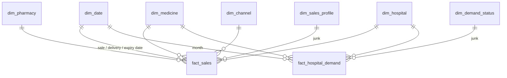

# Phase 1 — Sales & Demand Intelligence (SDI) mart: design

WBS 1.4 (profiling follow-up), 3.1 (dimensional model), 3.2.2 (validation rules).
Sources: `01_master_data.csv`, `05_pharmacy_sales_data.csv`, `06_hospital_demand_data.csv`.
DDL: `sql/mart/sdi_01_create_schema.sql`. Assumption checks: `ingestion/check_phase1_assumptions.py`.

---

## 1. What the profiling report told us

**Good news**
- Every primary key is unique and non-empty; no fully duplicated rows in any file.
- 0 orphan `MedicineID`s in 05 and 06 (all exist in master). 0 orphan batch IDs.
- `06` has exactly 12 hospitals × 63 medicines × 36 months = 27,216 rows → the grain is complete.
- No empty values in any Phase 1 key, date or money column. Min retail price is 2.38 (> 0).
- Date coverage is 2023-01 → 2025-12 for sales and demand, as the spec expects.

**Problems found and what we do about them**

| # | Finding | Why it matters | Decision |
|---|---|---|---|
| P1 | GTIN14 has 13 digits (e.g. `9506000000015`), GLNs 12 digits, SSCC18 17 digits | pandas read them as numbers and **dropped the leading zero**. A GTIN-14 must have 14 digits. | ODS loads **every column as text**. Transform zero-pads: `lpad(GTIN14,14,'0')`, `lpad(GLN,13,'0')`, `lpad(SSCC18,18,'0')`. |
| P2 | `07.SSCC18` profiled as float (`9.506001000800002e+16`) | Floats keep ~16 digits, so the last digits of an 18-digit code get **corrupted** and won't join to 03. | Same fix: read as text. (Phase 3 issue, but the ingestion code is shared.) |
| P3 | `03` key check says "LineNo not found" | The real column is `ShipmentLineNumber`. | Fix the key in `profile_sources.py`: `("ShipmentID", "ShipmentLineNumber")`. PK = ShipmentID + ShipmentLineNumber. |
| P4 | `03.OnTimeDeliveryFlag` flagged "999 unparseable dates" | Profiler false alarm: the name contains "Date", but the values are Y/N. | Ignore. |
| P5 | `05.HospitalID` 78 % empty | Only hospital-pharmacy sales have a hospital. | Not an error. `hospital_key = -1` ("Not a hospital sale") for the rest. |
| P6 | `05.PromotionCode` 84 % empty = exactly the 420,276 rows with 0 discount | Empty means "no promotion". | Store as `'NONE'` in the junk dimension. |
| P7 | `05.PrescriptionID` 7.46 % empty | Probably the OTC sales. | Rule S13 (confirm with check C5). |
| P8 | `06.TraumaLevel` 50 % empty | 6 of 12 hospitals are not trauma centres. | Store as `'Not designated'`. |
| P9 | `05` has no "channel" column with Retail / Hospital / E-commerce | The spec's channel split must be **derived**. | `Ecommerce` → E-commerce; else `PharmacyType = 'Hospital Pharmacy'` → Hospital; else Retail (confirm with C1). |
| P10 | Constant columns in master (`ProductStatus`, `EffectiveFromDate = 2023-01-01`, `ReorderReviewCycleDays`, `SourceSystem`) | They carry no information today. | Kept: `EffectiveFromDate` becomes the first `valid_from` of SCD2, and `ProductStatus` can change in generated data. |
| P11 | `05` repeats `GenericName`, `DiseaseCategory`, `GTIN14`, and `DeliveryQuantityPacks` on every row | Repeated text bloats facts; `DeliveryQuantityPacks` belongs to the delivery, so summing it over sales **double-counts**. | Drop them from `fact_sales`; medicine attributes come from `dim_medicine`. Delivery quantity moves to Phase 2. |
| P12 | No file "owns" HospitalID / PharmacyID / WarehouseID as a unique key | There is no hospital/pharmacy master file. | Build `dim_hospital` from distinct rows of 06 and `dim_pharmacy` from distinct rows of 05 (checks C3/C4 confirm they're stable). |
| P13 | Not Phase 1: `02.CostPerReleasedPackUSD` empty for the 5 batches with 0 released packs; `04.DockToStockHours` 99 % empty (only on receiving days) | Divide-by-zero / not applicable. | Note for Phase 2. |

---

## 2. Data validation rules (WBS 3.2.2)

**Where they run:** the ODS (Postgres `ods`) keeps the raw data exactly as received, like an inbox.
Validation runs in the **transform step**, before data enters the DuckDB mart, like a security check at the door.

- **REJECT** → the row does not enter the mart. It is written to `ods.rejected_rows` with the rule ID and the reason.
- **WARN** → the row is loaded, but `dq_warning_count` on the fact row goes up and a count is logged to `meta.dq_log`.

Every run logs `rule_id, rows_checked, rows_failed, etl_batch_id` to `meta.dq_log` (this feeds the dashboards).

### 01 master
| ID | Rule | Action |
|---|---|---|
| M1 | `MedicineID` not empty and unique | REJECT |
| M2 | `UnitManufacturingCostUSD`, `WholesalePriceUSD`, `RecommendedRetailPriceUSD` > 0 | REJECT |
| M3 | Manufacturing cost ≤ wholesale ≤ RRP | WARN |
| M4 | `StorageMinTempC` < `StorageMaxTempC` | REJECT |
| M5 | Y/N flags only contain Y or N; `PrescriptionClass` ∈ {Prescription, OTC} | REJECT |
| M6 | `GTIN14` is digits only and ≤ 14 long (then zero-padded) | REJECT |

### 05 pharmacy sales
| ID | Rule | Action |
|---|---|---|
| S1 | `SalesTransactionID` not empty, unique in the file, and **not already in `fact_sales`** (stops double loading on refresh) | REJECT |
| S2 | `MedicineID` not empty and exists in `dim_medicine` | REJECT |
| S3 | `PharmacyID` not empty | REJECT |
| S4 | `SalesDate` is a valid date between 2023-01-01 and the run date | REJECT |
| S5 | `SalesDate` = date part of `SalesTimestampUTC` | WARN |
| S6 | `UnitRetailPriceUSD` > 0 | REJECT |
| S7 | `QuantitySoldPacks` ≥ 1 | REJECT |
| S8 | `Gross = UnitPrice × Qty` (±0.01) | WARN |
| S9 | `Net = Gross − Discount` (±0.01) and 0 ≤ Discount ≤ Gross | WARN |
| S10 | `GrossMargin = Net − COGS` (±0.01) | WARN |
| S11 | `0 ≤ ReturnedQuantityPacks ≤ QuantitySoldPacks`; ReturnFlag = Y ⇔ Returned > 0 | WARN |
| S12 | `PharmacyDeliveryDate` ≤ `SalesDate` | WARN |
| S13 | `PrescriptionRequiredFlag = 'Y'` ⇒ `PrescriptionID` not empty | WARN |
| S14 | `BatchExpiryDate` ≥ `SalesDate` (no expired medicine sold) | WARN |
| S15 | `HospitalID` filled ⇔ `PharmacyType = 'Hospital Pharmacy'` | WARN |
| S16 | Coded columns only contain known values (`SalesChannel`, `PharmacyType`, `PayerType`, …; list from the "Allowed values" section of the check output). Unknown values map to the `-1` member. | WARN |

### 06 hospital demand
| ID | Rule | Action |
|---|---|---|
| H1 | `HospitalDemandRecordID` not empty, unique, and not already in the mart | REJECT |
| H2 | (`HospitalID`, `MedicineID`, `DemandMonth`) unique | REJECT |
| H3 | `DemandMonth` is a valid date, on the 1st of the month, between 2023-01 and the run month | REJECT |
| H4 | `MedicineID` exists in `dim_medicine`; `HospitalID` not empty | REJECT |
| H5 | All quantity columns ≥ 0 | REJECT |
| H6 | Approved ≤ Requested; Received ≤ Approved | WARN |
| H7 | Stock balance: `Closing = Opening + Received − Dispensed − Wastage` (exact formula confirmed by C12) | WARN |
| H8 | `ServiceLevelPct` between 0 and 100 | REJECT |
| H9 | `StockoutDays` between 0 and the number of days in the month | REJECT |

> Rules S8–S10 and H6–H7 are confirmed by `check_phase1_assumptions.py`. If a check shows the source data itself breaks a rule many times, we keep the rule as WARN and record that as a finding in the report.

---

## 3. Star schema (DuckDB, schema `sdi`)

Two stars that share the dimensions `dim_date`, `dim_medicine` and `dim_hospital`. That makes this a small **fact constellation** already.

### Facts
| Fact | Type | Grain | Measures |
|---|---|---|---|
| `fact_sales` | **Transaction** | 1 sales transaction (1 row of 05) | Additive: qty sold/returned/net, gross, discount, net, tax, COGS, margin. Non-additive: unit price, days to expiry |
| `fact_hospital_demand` | **Periodic snapshot** (monthly) | 1 hospital × medicine × month | Additive: forecast, requested, approved, received, emergency, dispensed, consumed, wastage, unfulfilled, stockout days. **Semi-additive**: opening/closing stock (sum across hospitals, never across months). Non-additive: service level %, lead time, trend index |

The fact types are like two diaries. A transaction fact is a receipt book: one entry each time something happens. A periodic snapshot is a monthly bank statement: one entry per account per month, whether anything happened or not. That's why closing stock can't be added up across months. Adding January's closing balance to February's makes no sense.

### Dimensions and the DWH techniques they demonstrate
| Dimension | Technique | Notes |
|---|---|---|
| `dim_date` | **Conformed, role-playing** | One table used 3 ways in `fact_sales` (sale date, pharmacy delivery date, batch expiry date) and as the month in demand. Key = `yyyymmdd`. Covers 2022–2029, so generated future data fits. |
| `dim_medicine` | **Conformed, SCD Type 2** | Price, cost, status, cold-chain and prescription changes create a new row (`valid_from`, `valid_to`, `is_current`). Names are Type 1 (overwritten). Facts pick the version valid on the event date. Reused in Phase 2 and 3. |
| `dim_hospital` | Conformed, SCD Type 1 | From 06. Shared by both facts. Derived `bed_size_band`. Member `-1` = "Not a hospital sale". |
| `dim_pharmacy` | SCD Type 1 | From 05. `linked_hospital_id` for hospital pharmacies. |
| `dim_channel` | Static / derived | Retail, Hospital, E-commerce (rule P9). |
| `dim_sales_profile` | **Junk dimension** | 9 low-cardinality flags (Rx flag, segment, payer, payment method, promo code, e-com status, return flag, sale status, OTIF). One small table instead of 9 columns × 500k rows. |
| `dim_demand_status` | **Junk dimension** | Request status × formulary status (6 combos). |
| (in facts) | **Degenerate dimensions** | Transaction, order, delivery and prescription IDs; batch, lot and warehouse IDs (these become real dimensions in Phase 2). |

Every dimension has a `-1` "Unknown / Not applicable" row, so fact foreign keys are never NULL.

### How it plugs into later phases (bus matrix)
| | Date | Medicine | Hospital | Pharmacy | Channel | Warehouse | Batch | Device/Vehicle |
|---|---|---|---|---|---|---|---|---|
| Phase 1 Sales | ✔ | ✔ | ✔ | ✔ | ✔ | (degenerate) | (degenerate) | |
| Phase 1 Hospital demand | ✔ | ✔ | ✔ | | | | | |
| Phase 2 Inventory | ✔ | ✔ | | | | ✔ | ✔ | |
| Phase 3 Cold chain | ✔ | ✔ | | | | ✔ | ✔ | ✔ |

### Refreshes (history is kept)
- Facts: **append only**. Rules S1/H1 skip IDs that are already loaded.
- Dimensions: upsert. Type 1 overwrites; Type 2 closes the old row and adds a new one.
- Every row carries `etl_batch_id` and `loaded_at`, so the demo can show "refresh 1 added X rows, refresh 2 added Y rows".
